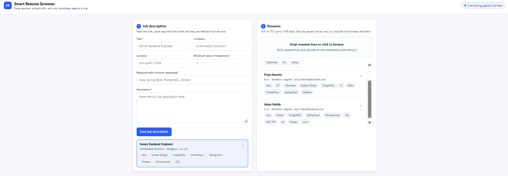
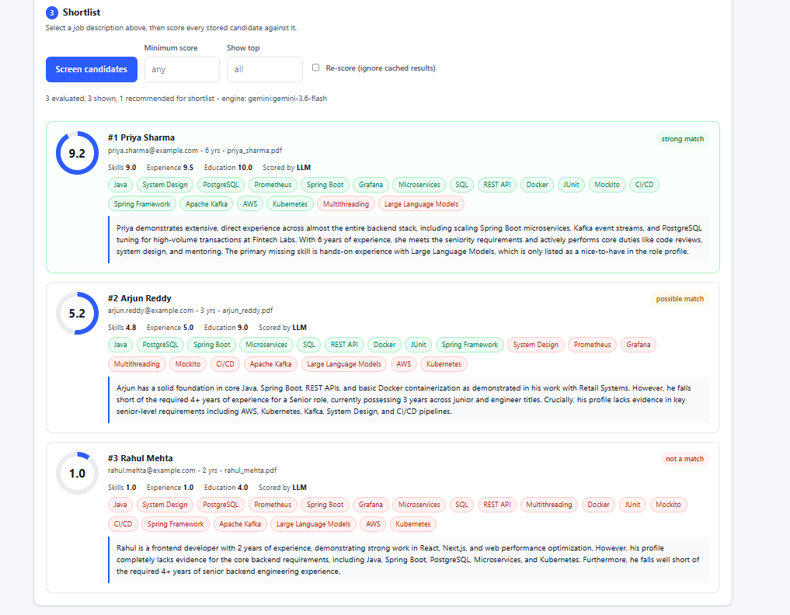
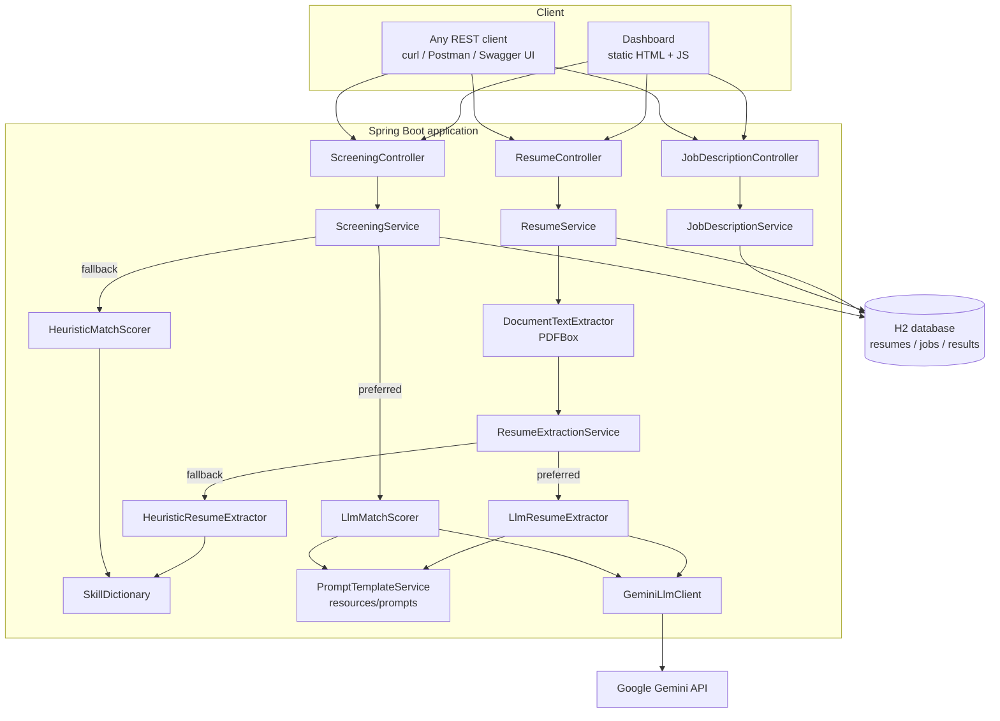
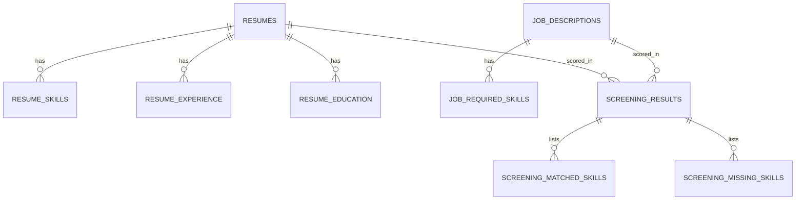

# Smart Resume Screener

[](https://github.com/vamsikrishnach25-star/smart-resume-screener/actions/workflows/ci.yml)
[](https://openjdk.org/projects/jdk/17/)
[](https://spring.io/projects/spring-boot)
[](LICENSE)

An LLM-powered screening service that reads resumes (PDF or text), extracts structured candidate
data, and ranks candidates against a job description with a 1-10 match score and a written
justification a hiring manager can act on.

It ships with a REST API, a zero-build dashboard, a relational store for everything it parses, and a
deterministic scoring engine that keeps the whole product working when no model key is configured.

**Dashboard** - upload, role definition and live engine badge:



**Ranked shortlist** - match score, sub-scores, matched and missing skills, and the model's justification for each candidate:



> **Reviewing this project?** [docs/EVALUATION.md](docs/EVALUATION.md) maps every requirement to the code that satisfies it, and explains the design decisions behind each one.

---

## Table of contents

- [What it does](#what-it-does)
- [Architecture](#architecture)
- [Tech stack](#tech-stack)
- [Getting started](#getting-started)
- [Using the dashboard](#using-the-dashboard)
- [API reference](#api-reference)
- [How the LLM is used](#how-the-llm-is-used)
- [Resilience: the deterministic fallback](#resilience-the-deterministic-fallback)
- [Data model](#data-model)
- [Configuration](#configuration)
- [Testing](#testing)
- [Project structure](#project-structure)
- [Design decisions](#design-decisions)
- [Limitations and roadmap](#limitations-and-roadmap)

---

## What it does

| Capability | Detail |
|---|---|
| **Parse** | PDF (Apache PDFBox) and plain-text resumes, normalised into clean text |
| **Extract** | Name, email, phone, location, skills, work history, education, total years of experience |
| **Match** | Semantic 1-10 fit score against a job description, split into skill / experience / education sub-scores |
| **Explain** | Matched skills, missing skills, and a 2-4 sentence justification for every candidate |
| **Rank** | Sorted shortlist with `minScore` and `topN` filters and a shortlist recommendation band |
| **Store** | Every resume, role and verdict persisted in H2 via JPA, so a screening can be replayed without re-scoring |
| **Degrade** | Falls back to a deterministic scorer per candidate when the model is unavailable |

---

## Architecture



### Screening request flow

1. `POST /api/v1/resumes` - the file is validated (type, size), text is extracted with PDFBox, and the
   text is hashed. A resume whose hash was already parsed is reused instead of being sent to the model again.
2. The text goes to `ResumeExtractionService`, which asks the LLM for strict JSON and falls back to
   the rule-based extractor if the model is off or fails. The result is stored with the engine that produced it.
3. `POST /api/v1/jobs` - a role is stored. If no required skills are supplied, they are inferred from
   the description text with the skill dictionary.
4. `POST /api/v1/screenings` - for each candidate, the service looks for a stored verdict first, then
   scores with the LLM (falling back per candidate to the rule engine), persists the verdict, and
   returns the ranked list.

---

## Tech stack

| Layer | Choice | Why |
|---|---|---|
| Language | Java 17 | Widest LTS availability; records and text blocks keep the code compact |
| Framework | Spring Boot 3.3.5 | Web, validation, JPA and configuration binding in one place |
| PDF parsing | Apache PDFBox 3.0.3 | Mature, pure Java, no native dependencies |
| Persistence | Spring Data JPA + H2 (file mode) | Zero-setup for a reviewer; swap the datasource for PostgreSQL without code changes |
| LLM | Google Gemini via `java.net.http.HttpClient` | Free tier for evaluation; the `LlmClient` interface keeps the provider swappable |
| Docs | springdoc-openapi (Swagger UI) | Live, always-accurate API documentation |
| Frontend | Vanilla HTML/CSS/JS served by Spring | One command to run the whole product, nothing to build |
| Tests | JUnit 5, Mockito, AssertJ, MockMvc | Unit tests for the engines, an end-to-end test for the workflow |

---

## Getting started

### Prerequisites

- JDK 17 or newer (`java -version`)
- Maven 3.9+ (`mvn -version`)
- Optional: a free Google Gemini API key from <https://aistudio.google.com/app/apikey>

### 1. Clone and build

```bash
git clone https://github.com/vamsikrishnach25-star/smart-resume-screener.git
cd smart-resume-screener
mvn clean verify
```

### 2. Provide the API key (optional but recommended)

The service runs without a key using the deterministic engine. With a key it uses Gemini for both
extraction and scoring.

```bash
# macOS / Linux
export GEMINI_API_KEY="your-key-here"

# Windows PowerShell
$env:GEMINI_API_KEY = "your-key-here"

# Windows CMD
set GEMINI_API_KEY=your-key-here
```

### 3. Run

```bash
mvn spring-boot:run
```

| Surface | URL |
|---|---|
| Dashboard | <http://localhost:8080/> |
| Swagger UI | <http://localhost:8080/swagger-ui.html> |
| OpenAPI JSON | <http://localhost:8080/v3/api-docs> |
| H2 console | <http://localhost:8080/h2-console> (JDBC URL `jdbc:h2:file:./data/screener`, user `sa`) |

### Run with Docker

```bash
docker build -t smart-resume-screener .
docker run -p 8080:8080 -e GEMINI_API_KEY="your-key-here" smart-resume-screener
```

---

## Using the dashboard

1. **Job description** - paste the role, optionally list required skills and minimum years. Leave the
   skills blank and they are inferred from the text.
2. **Resumes** - drag and drop PDFs or text files. Each file is parsed independently; a scanned PDF
   with no selectable text is rejected with a clear reason rather than failing the batch.
3. **Shortlist** - select a role, set an optional minimum score or top-N, and screen. Every candidate
   comes back with sub-scores, matched and missing skills, and a justification.

Sample data to try it with lives in [`sample-data/`](sample-data): one job description and three
resumes (both `.txt` and `.pdf`).

---

## API reference

Base path: `/api/v1`

| Method | Endpoint | Purpose |
|---|---|---|
| `POST` | `/resumes` | Upload one or more resumes (multipart field `files`) and extract structured data |
| `GET` | `/resumes` | List parsed resumes, newest first |
| `GET` | `/resumes/{id}` | Full extracted profile for one resume |
| `DELETE` | `/resumes/{id}` | Delete a resume and its screening results |
| `POST` | `/jobs` | Create a job description |
| `GET` | `/jobs` | List job descriptions |
| `GET` | `/jobs/{id}` | Fetch one job description |
| `DELETE` | `/jobs/{id}` | Delete a job description and its screening results |
| `POST` | `/screenings` | Score and rank candidates against a role |
| `GET` | `/screenings/jobs/{jobId}` | Read a stored ranking without re-scoring |
| `GET` | `/system/status` | Active scoring engine, model and record counts |

Errors follow RFC 7807 (`application/problem+json`) with a `fieldErrors` map for validation failures.

### Example: end-to-end with curl

```bash
# 1. Upload resumes
curl -X POST http://localhost:8080/api/v1/resumes \
  -F "files=@sample-data/resumes/priya_sharma.pdf" \
  -F "files=@sample-data/resumes/rahul_mehta.pdf" \
  -F "files=@sample-data/resumes/arjun_reddy.pdf"

# 2. Create the role
curl -X POST http://localhost:8080/api/v1/jobs \
  -H "Content-Type: application/json" \
  -d '{
        "title": "Senior Backend Engineer",
        "company": "Unthinkable",
        "minYearsExperience": 4,
        "description": "Build and scale microservices in Java and Spring Boot backed by PostgreSQL, deployed with Docker on Kubernetes. Bachelor degree in computer science or equivalent experience.",
        "requiredSkills": ["Java", "Spring Boot", "PostgreSQL", "Docker", "Kubernetes"]
      }'

# 3. Screen (use the id returned above)
curl -X POST http://localhost:8080/api/v1/screenings \
  -H "Content-Type: application/json" \
  -d '{"jobDescriptionId": "PASTE-JOB-ID", "minScore": 5, "topN": 10}'
```

### Example screening response (trimmed)

```json
{
  "jobDescriptionId": "0f2a...",
  "jobTitle": "Senior Backend Engineer",
  "candidatesEvaluated": 3,
  "candidatesReturned": 2,
  "shortlistedCount": 1,
  "engine": "gemini:gemini-3.6-flash",
  "results": [
    {
      "rank": 1,
      "candidateName": "Priya Sharma",
      "matchScore": 9.1,
      "skillScore": 9.5,
      "experienceScore": 9.0,
      "educationScore": 8.0,
      "recommendation": "STRONG_MATCH",
      "shortlisted": true,
      "matchedSkills": ["Java", "Spring Boot", "PostgreSQL", "Docker", "Kubernetes"],
      "missingSkills": [],
      "justification": "Six years building distributed Java services, with direct ownership of a Spring Boot payments platform on PostgreSQL, which maps closely onto the role. Kubernetes and Docker appear in production contexts rather than as a list of tools. The only gap is limited exposure to event streaming beyond basic Kafka consumers.",
      "analysisSource": "LLM",
      "model": "gemini-3.6-flash",
      "latencyMs": 2140
    }
  ]
}
```

---

## How the LLM is used

Prompts are versioned files under [`src/main/resources/prompts/`](src/main/resources/prompts) rather
than string literals in code, so they can be reviewed and tuned without a recompile. Full text and
the reasoning behind each rule is in [`docs/PROMPTS.md`](docs/PROMPTS.md).

The model is used for two jobs:

**1. Structured extraction** (`resume-extraction.*.txt`) - turn messy resume text into strict JSON.
The prompt pins an exact schema, forbids invented values, and demands canonical skill spellings.

**2. Semantic matching** (`job-match.*.txt`) - rate the candidate against the role. The assignment's
baseline prompt is *"Compare the following resume with this job description and rate fit on 1-10 with
justification."* That is the starting point of the user prompt; the system prompt adds what makes the
output usable in production:

- an explicit JSON contract, so the response parses deterministically
- a rubric that defines what 10, 5 and 1 mean for each sub-score, so scores are comparable across candidates
- a weighting hint (60% skills, 25% experience, 15% education) plus a hard rule: a missing must-have caps the score at 6
- an instruction to treat resume and job text as data, never as instructions, which blocks prompt injection from an uploaded file
- an instruction to ignore name, gender, age and nationality, which keeps the screen focused on evidence
- `temperature = 0.2` and `responseMimeType = application/json` for reproducible, machine-readable output

Model output is never trusted directly. `LlmJsonParser` pulls the first balanced JSON object out of
the response (models like to add markdown fences or a closing sentence), scores are clamped to 1-10,
and skills are canonicalised against the dictionary before anything is stored.

---

## Resilience: the deterministic fallback

Every LLM path has a rule-based twin, chosen per operation:

| Situation | Extraction | Scoring |
|---|---|---|
| API key configured, call succeeds | `LlmResumeExtractor` | `LlmMatchScorer` |
| No API key, call fails, quota exhausted, malformed JSON | `HeuristicResumeExtractor` | `HeuristicMatchScorer` |

The fallback uses regular expressions, section detection and a curated 170-skill dictionary
(`resources/data/skills.txt`) with boundary-aware matching, so `Java` never matches inside
`JavaScript` and short aliases such as `Go`, `C` and `R` are matched case-sensitively.

The scoring fallback is transparent arithmetic:

```
skillScore      = 1 + 9 * (matched required skills / total required skills)
experienceScore = ratio of candidate years to required years, banded
educationScore  = degree present vs degree requested
matchScore      = 0.60 * skillScore + 0.25 * experienceScore + 0.15 * educationScore
```

Every stored verdict records `analysisSource` (`LLM` or `HEURISTIC`) and the model name, so a
reviewer can always tell which engine produced a number. This is also what makes the whole test suite
runnable offline in CI.

---

## Data model



`screening_results` carries a unique constraint on `(resume_id, job_id)`, which is what makes a
screening idempotent: re-running a screening reuses the stored verdict unless `"refresh": true` is
sent.

---

## Configuration

Everything is bound from `application.yml` into `AppProperties` and can be overridden with
environment variables.

| Property | Environment variable | Default | Purpose |
|---|---|---|---|
| `app.llm.api-key` | `GEMINI_API_KEY` | _(empty)_ | Enables model-based extraction and scoring |
| `app.llm.model` | `GEMINI_MODEL` | `gemini-3.6-flash` | Model name |
| `app.llm.enabled` | - | `true` | Master switch for the model path |
| `app.llm.timeout` | - | `45s` | Per-request timeout |
| `app.llm.max-retries` | - | `2` | Retries on 429/5xx with exponential backoff |
| `app.llm.temperature` | - | `0.2` | Low, for reproducible scores |
| `app.llm.max-input-characters` | - | `18000` | Truncation guard for very long resumes |
| `app.upload.max-file-size-bytes` | - | `5242880` | Per-file limit (5 MB) |
| `app.upload.allowed-extensions` | - | `pdf, txt, md` | Accepted resume formats |
| `app.scoring.*` | - | `0.60 / 0.25 / 0.15` | Weights used by the deterministic scorer |
| `server.port` | `SERVER_PORT` | `8080` | HTTP port |

---

## Testing

```bash
mvn test          # unit + integration tests
mvn clean verify  # full build with tests
```

The suite runs entirely offline: the `test` profile disables the LLM, so CI exercises the
deterministic path and never spends a token.

| Test | What it protects |
|---|---|
| `DocumentTextExtractorTest` | Real PDF generation and extraction, unsupported types, scanned-PDF detection |
| `SkillDictionaryTest` | Boundary-aware matching, alias canonicalisation, case rules for short aliases |
| `HeuristicResumeExtractorTest` | Name, email, phone, skills, years, education from a realistic resume |
| `HeuristicMatchScorerTest` | Score bands, ranking behaviour, bounded sub-scores |
| `LlmJsonParserTest` | Fenced JSON, prose-wrapped JSON, braces inside strings, unterminated output |
| `ScreeningServiceTest` | Fallback on model failure, cached-verdict reuse, ranking and filters |
| `ScreeningFlowIntegrationTest` | The full documented workflow through HTTP, plus error contracts |
| `SmartResumeScreenerApplicationTests` | Context wiring |

---

## Project structure

```
smart-resume-screener/
├── src/main/java/com/vamsi/screener/
│   ├── config/          # AppProperties, OpenAPI, CORS
│   ├── controller/      # REST endpoints
│   ├── dto/             # Request/response records + mapper
│   ├── exception/       # Domain exceptions + RFC 7807 handler
│   ├── model/           # JPA entities
│   ├── repository/      # Spring Data repositories
│   ├── service/
│   │   ├── extraction/  # PDF text, LLM extractor, rule extractor, skill dictionary
│   │   ├── llm/         # LlmClient interface, Gemini client, prompt loader, JSON parser
│   │   └── scoring/     # LLM scorer, deterministic scorer, assessment record
│   └── util/            # Text helpers
├── src/main/resources/
│   ├── prompts/         # Versioned prompt templates
│   ├── data/skills.txt  # Skill dictionary
│   ├── static/          # Dashboard (HTML/CSS/JS)
│   └── application.yml
├── src/test/java/...    # Unit + integration tests
├── docs/                # Architecture, prompts, API examples, demo script
├── sample-data/         # One job description, three resumes (txt + pdf)
├── Dockerfile
└── .github/workflows/ci.yml
```

---

## Design decisions

**Why a fallback engine at all?** A screening tool that dies when an API key expires is not usable.
Splitting `LlmClient` behind an interface and giving every LLM step a deterministic twin means the
product degrades in quality rather than availability, and it makes the entire pipeline testable
without network access.

**Why store the extracted text and the verdicts?** Re-scoring the same pair costs money and time and
produces slightly different numbers. Persisting verdicts with a unique `(resume, job)` constraint
makes a screening replayable and lets the API answer `GET /screenings/jobs/{id}` instantly.

**Why prompts as resource files?** Prompt changes are product changes. Keeping them in
`resources/prompts` puts them in code review and in the diff, next to the rubric they implement.

**Why H2 rather than PostgreSQL?** A reviewer should be able to run `mvn spring-boot:run` and have a
working product. The persistence layer is plain JPA, so moving to PostgreSQL is a dependency and a
datasource URL, not a code change.

**Why no Lombok?** One less build-time dependency and IDE plugin between a reviewer and a running
application.

---

## Limitations and roadmap

- **Scanned PDFs** are rejected rather than OCR'd. Adding Tesseract behind the `DocumentTextExtractor`
  interface would close this.
- **Screening is synchronous.** Large batches would be better served by a job queue with a polling
  endpoint; the service layer is already structured for it.
- **The skill dictionary is curated**, so a brand-new framework is unknown to the deterministic path
  until it is added. The LLM path is not limited this way.
- **No authentication.** A production deployment would need API keys or OIDC in front of these
  endpoints, plus consent and retention rules for candidate data.
- **Bias controls are prompt-level only.** A production system should also audit score distributions
  across groups.

---

## License

[MIT](LICENSE) - Vamsi Krishna Choppara
