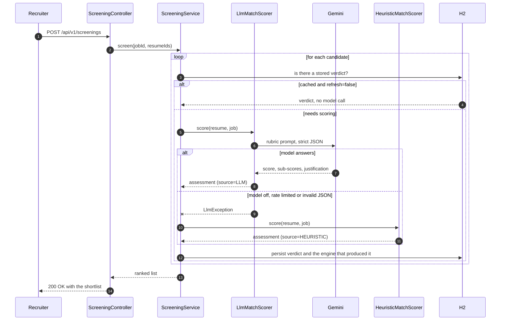

# Reviewer's guide

A map from every requirement in the brief to the code that satisfies it, so nothing has to be
hunted for. Times below assume a machine with JDK 17+ and Maven on the PATH.

## Two-minute tour

```bash
git clone https://github.com/vamsikrishnach25-star/smart-resume-screener.git
cd smart-resume-screener
mvn clean verify                 # full test suite, runs offline, no API key needed
export GEMINI_API_KEY="..."      # PowerShell: $env:GEMINI_API_KEY = "..."
mvn spring-boot:run              # dashboard at http://localhost:8080/
```

Drag the three files in `sample-data/resumes/` onto the dashboard, paste
`sample-data/job-description.txt` as the role, and press **Screen candidates**.

## Functional requirements

| # | Requirement | How it is met | Start reading at |
|---|---|---|---|
| 1 | Parse PDF and text resumes | PDFBox 3 text stripper, with a plain-text path and an explicit, actionable error for image-only PDFs | `service/extraction/DocumentTextExtractor.java` |
| 2 | Parse the job description | Stored as a role; required skills are inferred from the free text when the recruiter supplies none | `service/scoring/JobSkillResolver.java` |
| 3 | Extract structured data | Skills, years of experience, roles held and education, via an LLM extractor with a deterministic twin behind the same interface | `service/extraction/ResumeExtractionService.java` |
| 4 | LLM match score, 1 to 10 | A rubric prompt that defines what 10, 7, 5 and 1 mean, answered as strict JSON at temperature 0.2 | `service/scoring/LlmMatchScorer.java` |
| 5 | Justification per candidate | A required field in the model's JSON contract, persisted alongside the score | `model/ScreeningResult.java` |
| 6 | Show shortlisted candidates | Ranked cards with a score ring, three sub-scores, matched and missing skill chips | `resources/static/app.js` |
| 7 | Backend API | REST endpoints documented with OpenAPI 3; every error is RFC 7807 with a per-field breakdown | `controller/` |
| 8 | Frontend dashboard (optional) | Zero-build HTML, CSS and JS served by the application itself, no Node toolchain | `resources/static/index.html` |
| 9 | Database storage | Spring Data JPA over H2 in file mode; resumes, roles and verdicts all survive a restart | `repository/` |

## What happens on a screening request



## Against the evaluation criteria

### Code quality and structure

Controllers hold no logic, services hold no HTTP, and every entity is reached through a repository.
Extraction and scoring are each defined as an interface with two implementations, so the model-based
and rule-based engines are interchangeable and both are unit tested. Configuration is bound to a
typed `AppProperties` class rather than scattered `@Value` annotations, so every knob is discoverable
in one file.

### Data extraction

The skill dictionary matches on token boundaries rather than substrings, with per-alias edge rules,
so `Go` does not match `Google`, `R` does not match `React`, and `Kubernetes.` at the end of a
sentence still matches. `SkillDictionaryTest` pins that behaviour. Resumes are deduplicated by a
SHA-256 hash of their extracted text, so re-uploading the same file does not spend another API call.

### LLM prompt quality

Prompts are versioned files under `src/main/resources/prompts/`, not string literals, so a prompt
change shows up in a diff and goes through review like any other code. The rubric is explicit about
what each band means, forbids scoring above 6 when a hard requirement is missing, instructs the model
to treat resume text as data rather than as instructions, and bars protected attributes from
influencing the score. `docs/PROMPTS.md` reproduces every prompt in full with the reasoning for each
rule.

### Output clarity

Every verdict carries the score, three weighted sub-scores, the matched and missing skills that drove
it, a written justification, the engine that produced it and the latency. A recruiter can see not
only the ranking but why it came out that way, and an engineer can tell at a glance whether the model
or the fallback answered.

## Deliberate limitations

Documented rather than hidden, in the README under **Limitations and roadmap**. The main ones: no OCR
for scanned PDFs, single-node H2 rather than a clustered store, and no authentication layer, since
the brief scoped a screening service and not a deployed multi-tenant product.
